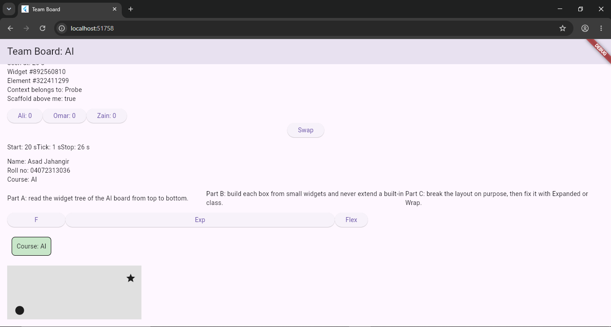

# CS442 — Team Board Lab Answers

**Student Name:** Asad Jahangir  
**Roll Number:** 04072313036  
**Course:** Mobile Application Development  
**Lab:** Team Board — Week 7

## Numerical Answers

A1: 26

A2: 7

A3: 2

A4: 50

## Written Answers

### B1: Which classes are Stateless and which are Stateful, and why?

**StatelessWidget classes:** LabApp, HomePage, SettingsCard, Probe, Welcome, InfoPanel, SummaryRow, ShareRow, InfoBox, and StampStack.

These classes do not manage their own changing State objects. They display information using their properties and build methods.

**StatefulWidget classes:** Clock, Tile, and SwapBoard.

Clock is Stateful because it updates the seconds and build count. Tile is Stateful because it counts button taps. SwapBoard is Stateful because it changes the order of the tiles.

### B2: Widget, Element, and RenderObject — which is rebuilt and which are kept? What did Probe show?

A Widget is a lightweight configuration object that can be replaced during rebuilding. An Element maintains a widget's location in the tree and preserves its associated State when applicable. A RenderObject handles layout and painting and is generally retained when its corresponding render element remains in place.

The Probe experiment showed that the Widget identity changed on rebuilds while the Element identity stayed the same. This demonstrates how Flutter updates widgets while reusing existing Elements.

### B3: Explain "constraints go down, sizes go up" using Step 7 or Step 8.

In Flutter, parent widgets pass layout constraints down to their children, and children report their calculated sizes back to their parents.

In Step 7, the Row initially contained three long Text widgets, which caused an overflow. Wrapping each Text in Expanded divided the available width into three equal portions. The Text widgets received limited widths and wrapped their words onto multiple lines. This removed the overflow and allowed the Row to display correctly.
 